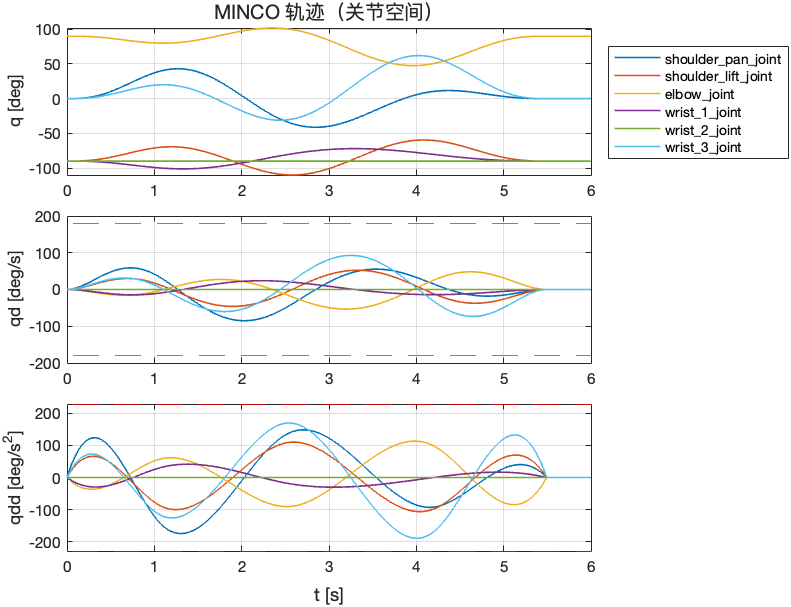
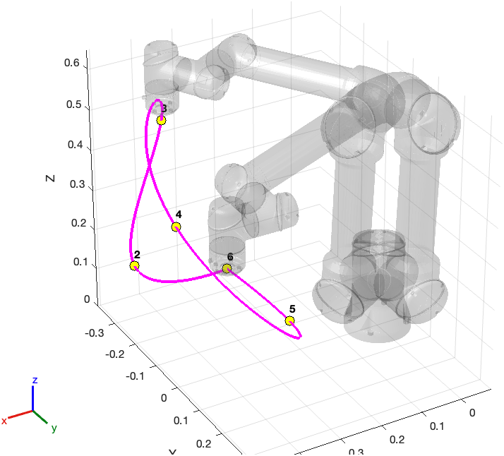
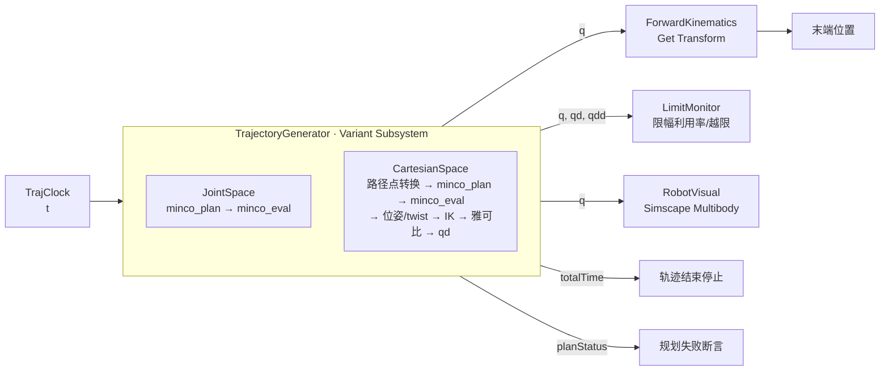

# MINCO 机械臂轨迹规划平台

基于 Simulink 的 6 轴机械臂轨迹规划平台。运动学由 Robotics System Toolbox 模块完成，轨迹规划层通过 **C Caller** 调用移植自 [GCOPTER](https://github.com/ZJU-FAST-Lab/GCOPTER) 的 **MINCO**（minimum-jerk，`MINCO_S3NU`），可视化使用 **Simscape Multibody / Mechanics Explorer**。

当前使用 UR5e 作为占位机器人，机器人定义集中在一个接口中，后续替换为 ROKAE（珞石）等机型的 URDF 只需修改配置。

| 关节空间轨迹 | 笛卡尔空间末端路径 |
|---|---|
|  |  |

## 教程

以本项目为 demo，系统学习 Simulink 机器人开发与 MINCO 算法的部署。每章按"原理 → 对照代码 → 动手实验 → 练习"组织，实验结果均在本项目中实测过。

| 章节 | 内容 |
|---|---|
| [第 0 章 学习路线与环境准备](docs/tutorial/00_学习路线与环境准备.md) | 学习路线、前置知识、环境安装与冒烟测试 |
| [第 1 章 Simulink 平台骨架](docs/tutorial/01_Simulink平台骨架.md) | 分层架构、参数结构体、变体子系统、采样时间与求解器 |
| [第 2 章 机器人建模与运动学](docs/tutorial/02_机器人建模与运动学.md) | rigidBodyTree、正逆运动学模块、雅可比与奇异 |
| [第 3 章 MINCO 算法原理](docs/tutorial/03_MINCO算法原理.md) | 最小 jerk 问题、带状线性系统、时间分配与缩放等变性 |
| [第 4 章 C 代码部署到 Simulink](docs/tutorial/04_C代码部署到Simulink.md) | extern "C" 包装、C Caller 配置、端口规格、执行顺序与缓存 |
| [第 5 章 笛卡尔空间规划](docs/tutorial/05_笛卡尔空间规划.md) | SO(3) 指数/对数映射、左雅可比、逐步 IK、阻尼最小二乘 |
| [第 6 章 Simscape 可视化](docs/tutorial/06_Simscape可视化.md) | URDF 导入、运动驱动关节、物理信号转换、Subsystem Reference |
| [第 7 章 仿真分析与调试](docs/tutorial/07_仿真分析与调试.md) | 结果分析、交叉验证、两个真实 bug 复盘、常见问题速查 |
| [第 8 章 练习与扩展](docs/tutorial/08_练习与扩展.md) | 分级练习、L-BFGS 时间优化、换装 ROKAE、ROS 2、在线重规划 |

## 功能

- **两种规划模式**（Variant Subsystem 切换）
  - 关节空间（MoveJ 式）：关节路径点 → 6 维 MINCO 轨迹
  - 笛卡尔空间（MoveL 式）：位置 + 姿态路径点 → 6 维 MINCO 轨迹 → 逐步 IK
- **自动时间分配**：梯形速度启发式分配分段时间，再整体缩放至恰好满足各维速度/加速度限幅，`timeScale` 留额外裕量
- **轨迹性质**：经过所有路径点，起止点速度、加速度为零；每段为 5 次多项式，路径点处位置到 snap（4 阶导数）均连续（C4）
- **监测**：速度/加速度限幅利用率、关节越限标志、规划失败断言、轨迹结束自动停止仿真
- **可视化**：Mechanics Explorer 三维动画 + 仿真后的关节曲线 / 限幅利用率 / 末端三维路径图

## 环境要求

| 依赖 | 说明 |
|---|---|
| MATLAB / Simulink R2024a 及以上 | 开发与验证版本为 R2024a Update 3 |
| Robotics System Toolbox | 机器人模型、IK、雅可比、正运动学模块 |
| Simscape、Simscape Multibody | 三维可视化 |
| C++ 编译器 | macOS: Xcode clang（`mex -setup C++`）；Windows: MSVC / MinGW |
| Eigen 3 | GCOPTER 依赖，macOS 可用 `brew install eigen` |

Eigen 按以下顺序自动查找：环境变量 `EIGEN3_INCLUDE_DIR` → `third_party/eigen` → `/opt/homebrew/include/eigen3` → `/usr/local/include/eigen3` → `/usr/include/eigen3`。

## 快速开始

```bash
git clone --recursive <本仓库地址>
# 已克隆但缺少子模块时：
git submodule update --init
```

在 MATLAB 中进入项目根目录：

```matlab
out = run_platform;                        % 使用配置中的规划模式，仿真并绘图
out = run_platform(PlanMode=2);            % 临时切换为笛卡尔空间规划
out = run_platform(Visualize=false);       % 不打开 Mechanics Explorer，批量仿真更快
```

也可以分步操作：

```matlab
startup_platform                 % 初始化路径、机器人模型、参数、自定义代码配置
open_system("RobotTrajPlatform") % 在 Simulink 中手动运行
```

> 首次仿真需要编译 C++ 自定义代码，耗时约几十秒，之后会快很多。

## 目录结构

```
├── run_platform.m              一键运行：初始化 → 仿真 → 绘图
├── startup_platform.m          初始化入口（路径、机器人、参数 P、变体、块参数同步）
├── config/
│   └── platform_config.m       全部可调参数（机器人来源、模式、路径点、限幅等）
├── robot/
│   ├── robot_definition.m      机器人统一定义接口（更换机器人只改这里的输入）
│   └── build_robot_visual.m    URDF → Simscape 可视化子系统 RobotVisual.slx
├── minco/
│   ├── minco_c_api.h           供 C Caller 调用的 C 接口
│   └── minco_c_api.cpp         extern "C" 包装 GCOPTER MINCO
├── models/
│   ├── RobotTrajPlatform.slx   主模型
│   └── RobotVisual.slx         自动生成的可视化子系统（Subsystem Reference）
├── scripts/
│   ├── configure_custom_code.m 为模型配置 C++ 自定义代码与包含路径
│   ├── find_eigen.m            查找 Eigen 头文件目录
│   └── plot_results.m          结果绘图
├── tools/
│   ├── minco_mex.cpp           MINCO 的 MEX 接口，用于在 MATLAB 命令行做实验
│   └── build_minco_mex.m       编译 minco_mex 到 build/
├── tests/
│   └── test_minco_c_api.cpp    MINCO C 接口的独立测试
├── docs/
│   ├── tutorial/               教程（第 0~8 章）
│   └── images/                 README 配图
├── third_party/GCOPTER/        git 子模块（MIT License）
└── build/                      生成文件（占位 URDF、测试程序、图片），不纳入版本管理
```

## 模型架构



### 关节空间 `JointSpace`

常量路径点、限幅 → `MincoPlan`（C Caller，`minco_plan`）→ 规划版本号 → `MincoEval`（C Caller，`minco_eval`，输入 t）→ q / qd / qdd。

### 笛卡尔空间 `CartesianSpace`

1. `CartWaypointsToVec`：每个路径点的 ZYX 欧拉角转为相对首个路径点的旋转向量 \(w_k\)，满足 \(R_k = R_0\,\mathrm{Exp}(w_k)\)，与位置组成 6 维向量
2. `MincoPlan` / `MincoEval`：对 \([p;\,w]\) 做 6 维 MINCO 规划与采样
3. `VecToPoseTwist`：还原位姿 \(R = R_0\,\mathrm{Exp}(w)\)，基座系角速度 \(\omega = R_0 J_l(w)\,\dot w\)
4. `InverseKinematics`：以上一步解为初值逐步求解关节角
5. `GeometricJacobian` + `TwistToJointVel`：阻尼最小二乘 \(\dot q = J^\top (J J^\top + \lambda^2 I)^{-1} [\omega; v]\)
6. `JointAccel`：对 qd 离散微分得到 qdd

两个变体使用不同的规划槽（slot 0 / 1），互不干扰。

## MINCO C 接口

```c
#define MINCO_MAX_DIM  6
#define MINCO_MAX_WPTS 16

int minco_plan(int slot, int dim, int numWpts, const double *wpts,
               const double *vMax, const double *aMax, double timeScale,
               double *durations, double *totalTime);

int minco_eval(int slot, int planVersion, double t,
               double *pos, double *vel, double *acc, double *jerk);
```

| 约定 | 说明 |
|---|---|
| `wpts` | `MINCO_MAX_DIM × MINCO_MAX_WPTS` 列主序（与 Simulink 一致），只使用前 `dim` 行、前 `numWpts` 列（含起点终点） |
| `minco_plan` 返回值 | `>0` 为规划版本号；输入不变时直接返回缓存结果，不重新求解；`<0` 为错误码（见头文件） |
| `minco_eval` 的 `planVersion` | 接 `minco_plan` 的输出，用于在 Simulink 中建立执行先后依赖 |
| `t` | 自动限制在 `[0, totalTime]`，结束后保持终点 |
| `timeScale` | 小于 1 时按 1 处理，以保证限幅 |

实现要点：

- GCOPTER 的 MINCO 固定为 3 维，而 MINCO 各维相互解耦，因此 6 维按两组 3 维、使用同一组分段时间分别求解，与整体求解等价，第三方源码无需修改
- 起止状态为静止时，最小 jerk 解对整体时间缩放是等变的，因此一次缩放即可让峰值速度/加速度恰好贴合限幅
- 采用定长数组和 C 侧静态存储，适配 C Caller，也便于后续代码生成

在 Simulink 中，接口头文件以 `extern "C"` 导出，模型的仿真目标与代码生成语言均设为 C++，包含路径与源文件由 `configure_custom_code.m` 在每次启动时写入。

## 配置说明（`config/platform_config.m`）

| 参数 | 含义 |
|---|---|
| `cfg.robot.source` | `"placeholder_ur5e"` 或 `"urdf"` |
| `cfg.robot.urdfFile` | `source = "urdf"` 时的 URDF 路径 |
| `cfg.robot.eeName` | 末端坐标系名 |
| `cfg.robot.vMax / aMax` | 关节限幅覆盖值，留空使用默认（速度优先读取 URDF） |
| `cfg.planMode` | 1 = 关节空间，2 = 笛卡尔空间 |
| `cfg.Ts` | 规划 / IK 采样周期，默认 4 ms |
| `cfg.timeScale` | 时间裕量系数（≥ 1） |
| `cfg.joint.waypointsDeg` | 关节路径点 [deg]，每行一个 |
| `cfg.cart.waypoints` | 笛卡尔路径点，每行 `[x y z(m) yaw pitch roll(deg)]` |
| `cfg.cart.vMax / aMax` | 笛卡尔限幅 `[m/s ×3, rad/s ×3]` / `[m/s² ×3, rad/s² ×3]` |
| `cfg.cart.qInitDeg` | 第一个笛卡尔路径点附近的 IK 初值 |
| `cfg.vis.openMechanicsExplorer` | 仿真时是否打开 Mechanics Explorer |

修改配置后重新运行 `startup_platform`（或直接 `run_platform`）即可生效。

## 更换机器人（如 ROKAE）

1. 获取机型的 URDF 与网格，例如珞石官方 `rokae_ros2` 包中的 `rokae_description`
2. 修改配置：

   ```matlab
   cfg.robot.source   = "urdf";
   cfg.robot.urdfFile = "<path>/rokae_description/urdf/xxx.urdf";
   cfg.robot.eeName   = "<末端 link 名>";
   ```

3. 重新生成可视化子系统：

   ```matlab
   startup_platform(RebuildVisual=true)
   ```

4. 按新机型的工作空间调整路径点、`cfg.cart.qInitDeg` 和限幅

启动脚本会自动把末端名和基座名同步到 IK、雅可比、正运动学模块（包括未激活的变体）。网格路径支持相对路径与 `package://` 形式。平台目前按 6 个运动关节设计，关节数不符时会报错。

## 可视化

- **Mechanics Explorer**：`RobotVisual.slx` 由 `build_robot_visual.m` 自动生成，流程为 `smimport` 导入 URDF → 修正网格路径 → 关节设为"输入运动 + 计算力矩" → 关节角经二阶滤波的 Simulink-PS 转换器驱动。该子系统仅做运动学回放，不做动力学仿真
- **`plot_results`**：仿真结束后绘制关节 q / qd / qdd（含限幅线）、限幅利用率曲线、末端三维路径（含路径点编号和半透明机器人位形）
- **Simulink 示波器**：`JointScope`（q / qd / qdd）、`MonitorScope`（限幅利用率、末端位置）
- **工作区变量**：`out.log_q`、`log_qd`、`log_qdd`、`log_eePos`、`log_limitRatio`（timeseries）

## 测试

MINCO C 接口可脱离 MATLAB 单独测试，覆盖路径点精度、起止静止、C2 连续、限幅贴合、缓存与重新规划、错误码：

```bash
mkdir -p build
clang++ -std=c++14 -O2 -Iminco -Ithird_party/GCOPTER/gcopter/include \
    -I/opt/homebrew/include/eigen3 \
    minco/minco_c_api.cpp tests/test_minco_c_api.cpp -o build/test_minco_c_api
./build/test_minco_c_api
```

也可以编译 MEX 接口，在 MATLAB 命令行中直接调用 MINCO（教程第 3 章的实验都基于它）：

```matlab
build_minco_mex
[ver, T, Ttot] = minco_mex('plan', 2, 3, W, vMax, aMax, 1.0);   % W: 3 × 路径点数
[pos, vel, acc, jerk, seg] = minco_mex('eval', 2, ver, linspace(0, Ttot, 500));
```

参考结果（占位机器人、默认配置）：

| 模式 | 轨迹时长 | 路径点误差 | 速度 / 加速度利用率峰值 |
|---|---|---|---|
| 关节空间 | 5.5 s | < 0.0014 rad | 0.52 / 0.83 |
| 笛卡尔空间 | 13.5 s | < 0.5 mm | 0.19 / 0.12 |

## 注意事项

- **奇异位形**：MINCO 曲线在急转处会向内侧弯。笛卡尔路径点离基座轴线太近时，会进入肩部奇异区，导致关节速度激增。若 `log_limitRatio` 的速度利用率超过 1，优先检查路径点位置
- **姿态范围**：笛卡尔模式下，各路径点的姿态应在首个路径点的 180° 以内（旋转向量表示的限制）
- **规模上限**：最多 16 个路径点、6 维；如需更多，修改 `minco_c_api.h` 中的宏以及 `startup_platform.m` 中的 `maxWpts` / `maxDim`
- **路径中的中文字符**：当前在含中文的路径下验证通过；若其他平台的编译器报路径错误，可将项目移到纯英文路径

## 后续计划

- [ ] 接入 GCOPTER 的 L-BFGS 时间分配优化与连续约束惩罚
- [ ] 笛卡尔模式输出 IK 误差与奇异度指标
- [ ] 运行时在线修改路径点 / 重规划触发
- [ ] ROS 2 关节状态发布，对接 RViz / 珞石 MoveIt 配置
- [ ] 替换为 ROKAE 实际机型并标定限幅

## 致谢与许可

- MINCO 实现来自 [ZJU-FAST-Lab/GCOPTER](https://github.com/ZJU-FAST-Lab/GCOPTER)（MIT License），以子模块形式引用，未作修改
- Z. Wang, X. Zhou, C. Xu, F. Gao, "Geometrically Constrained Trajectory Optimization for Multicopters," *IEEE Transactions on Robotics*, 2022.
