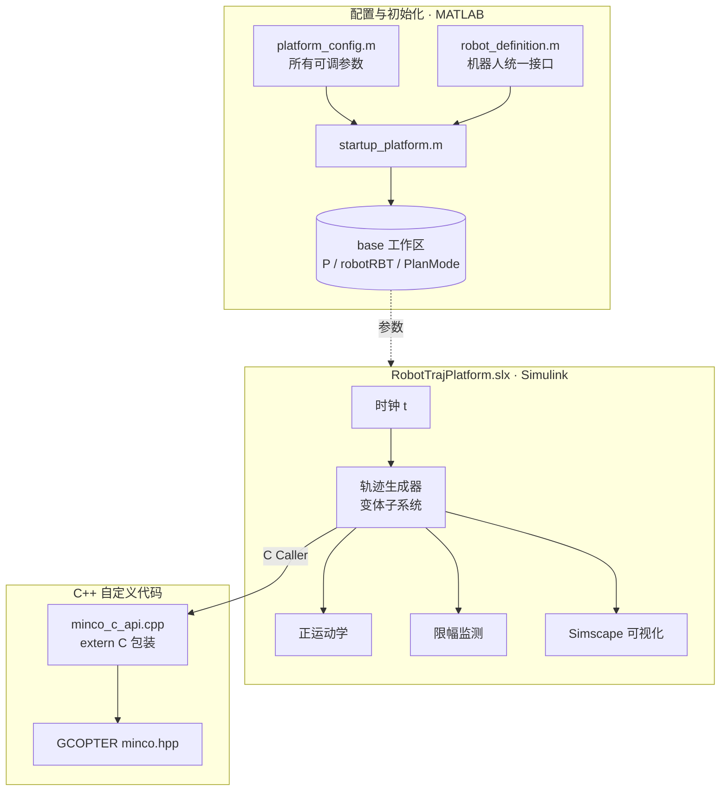

# 第 0 章 学习路线与环境准备

本教程以本仓库这个可运行的 demo 为载体，带你完整走一遍：

> **用 Simulink 搭机器人系统 → 理解 MINCO 轨迹优化 → 把第三方 C++ 算法部署进 Simulink → 可视化与调试**

每章都包含四部分：**原理**、**对照代码**、**动手实验**、**练习**。建议按顺序学习，每章动手实验都在 MATLAB 里亲自跑一遍。

## 0.1 你将学到什么

| 章节 | 主题 | 核心收获 |
|---|---|---|
| [第 1 章](01_Simulink平台骨架.md) | Simulink 平台骨架 | 模型分层、参数管理、变体子系统、采样时间与求解器 |
| [第 2 章](02_机器人建模与运动学.md) | 机器人建模与运动学 | rigidBodyTree、URDF、FK/IK/雅可比模块、坐标系约定、奇异性 |
| [第 3 章](03_MINCO算法原理.md) | MINCO 算法原理 | 最小 jerk 问题、最优性条件、带状线性系统、GCOPTER 源码逐行对照 |
| [第 4 章](04_C代码部署到Simulink.md) | C/C++ 部署到 Simulink | C Caller、`extern "C"`、自定义代码配置、端口规格、状态缓存 |
| [第 5 章](05_笛卡尔空间规划.md) | 笛卡尔空间规划 | SO(3) 旋转向量、指数/对数映射、左雅可比、逐步 IK、阻尼最小二乘 |
| [第 6 章](06_Simscape可视化.md) | Simscape 可视化 | URDF 导入、运动驱动关节、Simulink-PS 转换、Subsystem Reference |
| [第 7 章](07_仿真分析与调试.md) | 仿真分析与调试 | 数据记录、结果绘图、两个真实 bug 的完整复盘 |
| [第 8 章](08_练习与扩展.md) | 练习与扩展 | 分级练习、时间优化、换真机、ROS 2 对接 |

## 0.2 前置知识

不需要全部精通，遇到不懂的地方再回头查即可：

- **MATLAB 基础**：矩阵运算、函数、结构体
- **Simulink 基础**：会拖模块、连线、运行仿真、看 Scope
- **线性代数**：矩阵乘法、线性方程组、伪逆
- **机器人学入门**：齐次变换、正/逆运动学的概念（推荐《Modern Robotics》前 6 章）
- **C/C++ 基础**：函数、指针、数组、头文件与编译链接

## 0.3 环境准备

### 软件

| 依赖 | 用途 | 检查方法 |
|---|---|---|
| MATLAB / Simulink R2024a+ | 主体 | `ver` |
| Robotics System Toolbox | 机器人模型与运动学模块 | `ver robotics` |
| Simscape + Simscape Multibody | 三维可视化 | `ver sm` |
| C++ 编译器 | 编译 MINCO | `mex -setup C++` |
| Eigen 3 | GCOPTER 的线性代数依赖 | macOS：`brew install eigen` |

### 获取代码

```bash
git clone --recursive <本仓库地址>
cd <仓库目录>
# 如果克隆时忘了 --recursive：
git submodule update --init
```

`third_party/GCOPTER` 是一个 git 子模块，里面是浙大 FAST-Lab 开源的 GCOPTER（MIT 许可），我们只使用其中的 `minco.hpp`，**不修改任何第三方源码**。

### 冒烟测试

在 MATLAB 中进入仓库根目录：

```matlab
out = run_platform;
```

预期结果：

1. 命令行打印 `平台已初始化：机器人 placeholder_ur5e ...`
2. 打开 Simulink 模型 `RobotTrajPlatform` 和 Mechanics Explorer 窗口，机械臂动起来
3. 仿真约 6 秒后自动停止，弹出三张结果图

> 首次运行需要编译 C++ 代码，可能需要几十秒到一分多钟，这是正常的。

如果报错，先看 [第 7 章 7.5 常见问题](07_仿真分析与调试.md#75-常见问题速查)。

## 0.4 项目全景

先建立整体印象，后面各章会逐块拆开讲：



三层的分工是：

- **MATLAB 层**负责"准备"：读配置、建机器人模型、整理参数、配置编译选项
- **Simulink 层**负责"系统"：信号流、时序、模块化、可视化
- **C++ 层**负责"算法"：MINCO 求解，和 Simulink 解耦，可以单独测试、单独移植到嵌入式

这个分层本身就是工程上常见的做法，值得在你自己的项目里复用。

## 0.5 推荐学习方式

1. **先跑通再拆解**：每章开头先运行对应的实验，看到现象再读原理
2. **改参数看变化**：每个结论都尽量通过改一个参数来验证
3. **对照源码**：文中引用的代码都能在仓库里找到，打开对照着读
4. **做练习**：[第 8 章](08_练习与扩展.md)的练习按难度分级，至少完成基础级

下一章：[第 1 章 Simulink 平台骨架](01_Simulink平台骨架.md)
