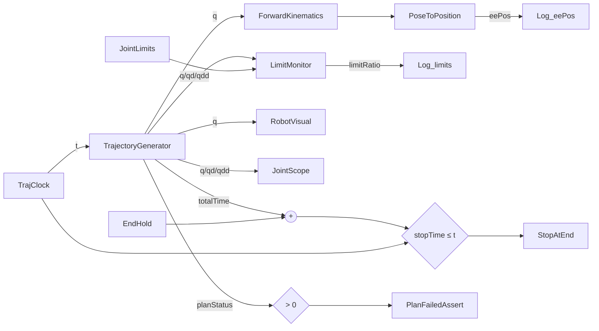

# 第 1 章 Simulink 平台骨架

本章目标：看懂 `RobotTrajPlatform.slx` 的整体结构，掌握一个"可维护的 Simulink 工程"需要的几个基本功：**分层、参数管理、变体、采样时间、仿真控制**。

## 1.1 先动手：观察模型

```matlab
startup_platform
open_system("RobotTrajPlatform")
```

顶层大致是这样的信号流：



在 Simulink 中打开 **Debug → Information Overlays → Sample Time → Colors**，再按 `Ctrl+D` 更新模型，可以看到不同颜色代表不同采样时间（后面 1.5 节解释）。

## 1.2 分层设计：每层只做一件事

| 层 | 模块 | 职责 | 对外接口 |
|---|---|---|---|
| 任务输入 | `Waypoints` 等常量 | 提供路径点、限幅 | 参数结构体 `P` |
| 轨迹生成 | `TrajectoryGenerator` | 路径点 → 随时间变化的关节指令 | 输入 `t`，输出 `q, qd, qdd, totalTime, planStatus` |
| 运动学 | `ForwardKinematics` 等 | 关节空间 ↔ 笛卡尔空间 | 机器人模型 `robotRBT` |
| 监测 | `LimitMonitor`、停止/断言 | 检查限幅、控制仿真结束 | 限幅利用率 |
| 可视化 | `RobotVisual` | 三维显示 | 输入 `q` |

关键设计原则：**层与层之间只通过少量、含义明确的信号交互**。例如轨迹生成器不管内部用的是关节空间还是笛卡尔空间，对外永远输出同样 5 个信号。这样：

- 可视化、监测模块完全不用关心规划算法
- 以后换算法（比如换成 MINCO s=4 或别的规划器）只动一个子系统
- 以后接真机，只要把 `q` 送给控制器即可

## 1.3 参数管理：结构体 `P` + 配置文件

模型里**不写死任何数字**，所有参数都来自 base 工作区的结构体 `P`。看几个例子：

| 模块 | 参数 |
|---|---|
| `TrajClock` | `SampleTime = P.Ts` |
| 关节空间 `Waypoints` | `Value = P.joint.wpts` |
| `EndHold` | `Value = P.endHold` |
| `JointLimits` | `Value = [P.qMin P.qMax P.vMax P.aMax]` |

参数的来源链路：

```
config/platform_config.m   人类友好：角度用 deg，路径点每行一个
        │  startup_platform.m → make_params()
        ▼
base 工作区 P              模型友好：rad、列向量、补零到固定尺寸、int32
        │
        ▼
Simulink 模块参数
```

为什么要多一层 `make_params` 转换？看 `startup_platform.m` 中的一段：

```matlab
qW = deg2rad(cfg.joint.waypointsDeg).';          % 每行一个点 → 每列一个点，deg → rad
checkWaypoints(qW, n, maxWpts, "关节");           % 维度、数量检查
outOfRange = qW < P.qMin | qW > P.qMax;           % 关节限位检查
...
P.joint.wpts = padWaypoints(qW, maxDim, maxWpts); % 补零成 6×16 固定矩阵
P.joint.numWpts = int32(size(qW, 2));             % C 接口需要 int32
```

这里做了三件事，都是工程中常见的需求：

1. **单位与格式转换**：用户写角度，模型用弧度
2. **前置校验**：在仿真前就把错误路径点拦下来，报出人能看懂的错误信息
3. **适配下游接口**：C 函数要求固定尺寸数组和 `int32`（第 4 章详述）

> **工程提示**：更大型的项目通常用 Simulink Data Dictionary（`.sldd`）代替 base 工作区，好处是参数随模型版本管理、不会被 `clear` 掉。本 demo 为了易读使用 base 工作区，思路是一样的。

## 1.4 变体子系统：一个模型，两种算法

`TrajectoryGenerator` 是一个 **Variant Subsystem**，内部有两个选项：

| 选项 | 变体条件 | 含义 |
|---|---|---|
| `JointSpace` | `VC_JointSpace` | 关节空间规划 |
| `CartesianSpace` | `VC_CartesianSpace` | 笛卡尔空间规划 |

变体条件在 `startup_platform.m` 中定义：

```matlab
assignin("base", "PlanMode", cfg.planMode);
assignin("base", "VC_JointSpace", Simulink.Variant("PlanMode == 1"));
assignin("base", "VC_CartesianSpace", Simulink.Variant("PlanMode == 2"));
```

**变体 vs. Switch 模块**：用 Switch 也能切换，但两条支路都会执行；变体子系统在编译时只保留激活的那一个，未激活的支路不参与仿真、也不生成代码。对于笛卡尔分支这种每步都要做 IK 的重计算，这个区别很重要。

规则：**各选项的端口名必须一致**。变体子系统层面不能连线，Simulink 按端口名自动匹配，所以两个选项内部都要有 `t` 输入和 `q, qd, qdd, totalTime, planStatus` 输出。

### 动手实验 1-1：切换模式

```matlab
PlanMode = 2;              % 直接改工作区变量
sim("RobotTrajPlatform");  % 这次用笛卡尔分支
```

或者用 `run_platform(PlanMode=2)`。观察 `TrajectoryGenerator` 图标上显示的激活选项变化。

> **踩坑提示**：未激活的变体在很多编辑操作和 `find_system` 中默认是"看不见"的。想编辑 `CartesianSpace` 内部，最简单的办法是先 `PlanMode = 2` 让它激活。脚本里要搜索所有变体，需要加 `MatchFilter=@Simulink.match.allVariants`，`startup_platform.m` 里的 `configure_robot_blocks` 就是这样做的。

## 1.5 采样时间与求解器

这个模型里同时存在三类采样时间：

| 类型 | 例子 | 含义 |
|---|---|---|
| 常量 `inf` | 路径点、限幅等 `Constant` | 只在初始化时计算一次 |
| 离散 `P.Ts = 0.004` | `TrajClock`、C Caller、IK、单位延迟 | 每 4 ms 执行一次，对应真实控制器周期 |
| 连续 | Simscape 机构 | 由求解器积分 |

为什么规划层用离散采样？因为它最终要部署到控制器上，控制器就是周期性执行的。在仿真中保持同样的周期，仿真结果更接近实际。

求解器配置（模型的 Configuration Parameters）：

| 设置 | 值 | 原因 |
|---|---|---|
| 类型 | Variable-step | 模型中有 Simscape 连续部分 |
| 求解器 | `ode23t` | Simscape 推荐的中等刚性求解器 |
| MaxStep | `P.Ts` | 保证可视化不会因步长太大而跳帧 |
| StopTime | `inf` | 由 `StopAtEnd` 模块根据轨迹时长自动停止 |

> **思考**：如果只做规划、不要 Simscape，可以改成 Fixed-step 离散求解器 `discrete`，仿真会快很多。这也是部署到嵌入式时的配置。

## 1.6 仿真控制：自动停止与断言

规划出来的轨迹时长事先未知，所以 StopTime 设为 `inf`，由模型自己决定何时停：

```
stopTime = totalTime + P.endHold
当 stopTime ≤ t 时，Stop 模块停止仿真
```

`EndHold` 让轨迹结束后再多仿真 0.5 秒，方便观察机械臂停稳。

`PlanFailedAssert`：当 `planStatus ≤ 0`（规划失败，见第 4 章错误码）时，Assertion 模块直接报错停止。**让失败尽早、大声地暴露**，比默默输出错误轨迹好得多。

## 1.7 数据记录

| 方式 | 本项目用法 | 特点 |
|---|---|---|
| To Workspace | `Log_q` 等，保存为 timeseries | 简单直接，仿真结束后在 `out.log_q` 中 |
| Scope | `JointScope`、`MonitorScope` | 仿真时实时查看 |
| 信号日志（Data Logging） | 调试时临时打开 | 不用加模块，在 Simulation Data Inspector 中查看 |

```matlab
out = sim("RobotTrajPlatform");
q = out.log_q;           % timeseries
plot(q.Time, squeeze(q.Data))
```

> **小坑**：To Workspace 保存的 `Data` 维度可能是 `N×6` 也可能是 `6×1×N`，取决于信号维度。`plot_results.m` 里的 `toRows` 函数就是为了统一处理这个问题。

## 1.8 本章小结

- 模型按"输入 → 规划 → 运动学 → 监测/可视化"分层，层间接口固定
- 所有参数来自 `P`，`P` 由配置文件经过转换和校验生成
- 变体子系统让同一个模型支持多种算法，且未激活分支不参与计算
- 离散规划层 + 连续可视化层共存，求解器选变步长并限制最大步长
- 用 Stop 和 Assertion 让仿真自己控制结束和报错

## 1.9 练习

1. 把 `cfg.endHold` 改成 2，观察仿真结束时间的变化。
2. 在 `JointSpace` 中把 `MincoEval` 的 `jerk` 输出接到一个新的 Scope 上，观察 jerk 曲线（提示：jerk 是分段二次多项式）。
3. 思考：如果要支持第三种规划模式（比如"直接加载示教轨迹文件"），需要改哪些地方？

下一章：[第 2 章 机器人建模与运动学](02_机器人建模与运动学.md)
