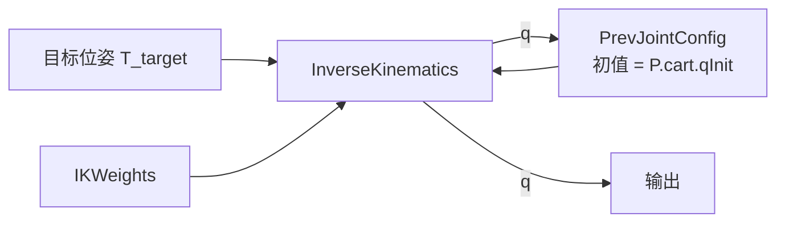

# 第 2 章 机器人建模与运动学

本章目标：掌握 MATLAB 中机器人模型 `rigidBodyTree` 的来源与结构，学会使用 Simulink 中的 FK / IK / 雅可比模块，理解坐标系约定和奇异性这两个最容易出错的地方。

## 2.1 机器人模型从哪里来

MATLAB 中所有运动学计算都基于 `rigidBodyTree` 对象，它有三种来源：

| 来源 | 函数 | 适用场景 | 是否带网格 |
|---|---|---|---|
| 内置模型库 | `loadrobot("universalUR5e")` | UR、KUKA、Franka、ABB 等常见机型 | 有 |
| URDF 文件 | `importrobot("xxx.urdf")` | 厂商提供 URDF（如 ROKAE 官方 ROS 包） | 有（取决于 URDF） |
| DH 参数 | 手动 `rigidBody` + `setFixedTransform` | 只有 DH 表 | 无，需手动添加 |

**优先级：内置库 > URDF > DH**。来源越靠前，越不容易出现连杆长度、关节轴方向等低级错误，而且自带视觉和碰撞网格。

### 动手实验 2-1：认识 rigidBodyTree

```matlab
robot = loadrobot("universalUR5e", DataFormat="row");
showdetails(robot)        % 打印每个刚体、关节类型、父子关系
robot.BaseName            % 'base_link'
q = homeConfiguration(robot)
show(robot, q);           % 三维显示

```

`showdetails` 的输出中你会看到 10 个刚体，但只有 6 个是 `revolute` 关节，其余是 `fixed`。固定关节用来表示法兰、工具坐标系等，不增加自由度。

> `DataFormat="row"` 表示关节位形用行向量 `1×6`。这是规划类函数推荐的格式，本项目统一使用。

## 2.2 统一机器人接口：`robot_definition.m`

平台的其余部分**从不直接调用** `loadrobot` 或 `importrobot`，而是统一通过 `robot_definition` 获取机器人：

```matlab
robot = robot_definition(cfg.robot, buildDir);
```

返回的结构体：

| 字段 | 含义 | 谁在用 |
|---|---|---|
| `rbt` | `rigidBodyTree` | IK/FK/雅可比模块（以 `robotRBT` 的名字放进工作区） |
| `urdfFile` | URDF 绝对路径 | Simscape 可视化生成（第 6 章） |
| `eeName` | 末端坐标系名 | IK/FK 模块 |
| `jointNames` | 6 个运动关节名 | 可视化中关节与信号的对应 |
| `qMin/qMax/vMax/aMax` | 关节限幅 | 规划、监测 |

这是一个典型的**适配器模式**：不同来源的机器人，经过 `robot_definition` 后都变成同样的结构体。占位机器人分支还做了一件额外的事——把内置 UR5e 导出成 URDF：

```matlab
case "placeholder_ur5e"
    rbt = loadrobot("universalUR5e", DataFormat="row");
    urdfFile = exportPlaceholderUrdf(rbt, fullfile(buildDir, "placeholder_urdf"));
```

这样，无论是占位机器人还是将来的 ROKAE，Simscape 可视化都走"从 URDF 导入"这一条路径，**避免了两套代码**。

另外两处值得学习的细节：

- **速度限幅从 URDF 读取**：`rigidBodyJoint` 对象不保存速度限制，`urdfVelocityLimits` 直接解析 URDF 中的 `<limit velocity="...">`
- **尽早校验**：末端坐标系名不存在、关节数不是 6，都会在启动时立即报错并列出可选项

## 2.3 Simulink 中的运动学模块

Robotics System Toolbox 在库 `robotmaniplib` 中提供了一组模块，本项目用到三个：

| 模块 | 本项目中的名字 | 输入 | 输出 |
|---|---|---|---|
| Get Transform | `ForwardKinematics` | 关节角 q | 4×4 齐次变换 |
| Inverse Kinematics | `InverseKinematics` | 目标位姿、权重、初值 | 关节角、求解信息 |
| Get Jacobian | `GeometricJacobian` | 关节角 q | 6×6 几何雅可比 |

它们都有一个参数 `RigidBodyTree`，填工作区变量名 `robotRBT`。另一个参数 `SimulateUsing` 建议设为 `Code generation`，比解释执行快得多。

机器人相关的坐标系名（末端名、基座名）不在模型里手写，而是由 `startup_platform.m` 的 `configure_robot_blocks` 在启动时根据 `robot_definition` 的结果自动写入。换机器人时不用手动改模块。

## 2.4 坐标系约定：最容易出错的地方

### Get Transform 的方向

`Get Transform` 模块有 `SourceBody` 和 `TargetBody` 两个参数，它输出的是：

> **将 Source 坐标系中的点变换到 Target 坐标系的变换矩阵**，也就是 *Source 在 Target 中的位姿*。

所以要得到"末端在基座中的位姿"，应该设：

```
SourceBody = tool0
TargetBody = base_link
```

本项目开发时就曾把这两个设反（见[第 7 章 7.3 节](07_仿真分析与调试.md#73-bug-复盘-1正运动学方向设反)），得到的是逆变换，末端位置完全不对，而且模型不会报任何错误。

### 动手实验 2-2：验证方向约定

```matlab
q = homeConfiguration(robotRBT); q(2) = -1;
A = getTransform(robotRBT, q, "tool0");                % 默认相对基座
B = getTransform(robotRBT, q, "tool0", "base_link");   % 显式指定 source → target
C = getTransform(robotRBT, q, "base_link", "tool0");   % 反过来
norm(A - B)        % 0
norm(A * C - eye(4))  % 0，C 是 A 的逆
```

### 其他约定

| 项目 | 约定 |
|---|---|
| IK 权重 | `[姿态×3, 位置×3]`，本项目全部为 1 |
| 几何雅可比的行顺序 | `[角速度 ω; 线速度 v]`，第 5 章计算 twist 时必须对应 |
| 欧拉角 | 本项目笛卡尔路径点用 ZYX 顺序：`[yaw pitch roll]` |

> **经验**：每次接入新的运动学函数，先用一个已知位形做 2-2 这样的小实验确认约定，再往系统里接。

## 2.5 逆运动学：数值迭代与初值

`Inverse Kinematics` 模块是**数值迭代求解器**（默认 BFGS 梯度投影），不是解析解。这带来两个重要性质：

1. **结果依赖初值**：6 轴机械臂对同一位姿通常有多达 8 组解，从哪个初值出发就收敛到附近那组
2. **可能不收敛**：目标不可达或靠近奇异位形时，`Info.ExitFlag` 会异常、`PoseErrorNorm` 变大

在笛卡尔模式中，初值来自上一步的解（`PrevJointConfig` 单位延迟）：



**为什么这样做？** 相邻两步的目标位姿只差一点点，用上一步的解作初值，迭代几次就收敛，而且保证关节角连续、不会在不同解之间跳变。单位延迟同时打破了代数环。

第一步的初值 `P.cart.qInit` 由配置 `cfg.cart.qInitDeg` 给出，应选在第一个路径点对应解的附近。

## 2.6 奇异性

当雅可比矩阵 \(J(q)\) 降秩时，机械臂在某些方向上失去运动能力，这就是**奇异位形**。在奇异点附近：

- 末端走很小一段，关节可能需要转很大角度
- IK 收敛变差，解可能突变
- 用 \(J^{-1}\) 求关节速度会数值爆炸

UR 类构型（6 轴、后三轴不交于一点）有三类典型奇异：

| 类型 | 条件 | 直观理解 |
|---|---|---|
| 肩部奇异 | 腕部落在基座 z 轴附近的特定曲面上（位置与肩部偏置 \(d_4\)、末端朝向有关） | 关节 1 转动对腕部几乎没有作用 |
| 肘部奇异 | 大臂和小臂共线（伸直） | 到达工作空间边界 |
| 腕部奇异 | 关节 5 接近 0 | 关节 4 和 6 轴共线 |

本项目开发时遇到的就是**肩部奇异**：第一版笛卡尔路径的末端距离基座轴线最近只有约 0.135 m，结果关节 1 速度激增到限值的 8 倍（复盘见[第 7 章 7.4 节](07_仿真分析与调试.md#74-bug-复盘-2穿越肩部奇异)）。

### 动手实验 2-3：观察可操作度

可操作度 \(w = \sqrt{\det(J J^\top)}\) 越接近 0 越奇异。下面让工具竖直朝下，沿 x 轴从远处逐渐靠近基座轴线：

```matlab
robot = robotRBT;
r = linspace(0.05, 0.7, 200);
w = zeros(size(r));
ik = inverseKinematics(RigidBodyTree=robot);
q0 = deg2rad([0 -92 113 -111 -90 -90]);
for i = numel(r):-1:1                       % 从远到近，用上一个解作初值
    T = trvec2tform([r(i) 0 0.35]) * eul2tform([0 0 pi], "ZYX");
    [q, info] = ik("tool0", T, ones(1,6), q0);
    J = geometricJacobian(robot, q, "tool0");
    w(i) = sqrt(abs(det(J * J.')));
    q0 = q;
end
plot(r, w); xlabel("末端到基座轴线的距离 [m]"); ylabel("可操作度");
```

远处（r = 0.4 m）可操作度约 0.05，靠近基座轴线时骤降到接近 0（本实验中约在 r ≈ 0.08 m 处）。奇异的具体位置取决于末端朝向，因为奇异条件针对的是腕部，而工具点与腕部之间还有 \(d_5, d_6\) 的偏置。改变 `eul2tform` 中的 yaw 再试一次，看看奇异位置如何移动。

## 2.7 本章小结

- 机器人模型优先用内置库或 URDF，统一经过 `robot_definition` 适配
- 运动学模块都指向工作区的 `robotRBT`，坐标系名在启动时自动同步
- Get Transform 输出"Source 在 Target 中的位姿"，方向搞反不会报错
- 数值 IK 依赖初值，逐步 IK 用上一步解作初值保证连续
- 笛卡尔规划必须避开奇异区，可操作度是一个简单的检查指标

## 2.8 练习

1. 用 `loadrobot("frankaEmikaPanda")` 看看 7 轴机器人的 `showdetails`，思考平台要支持 7 轴需要改哪些地方（提示：`robot_definition` 中的关节数检查、`MINCO_MAX_DIM`）。
2. 修改动手实验 2-3，扫描关节 5 从 -90° 到 0°，观察腕部奇异。
3. 把 `ForwardKinematics` 的 `TargetBody` 改成 `base`（UR 模型中另一个基座坐标系），对比末端位置的差别，并解释原因（提示：看 `showdetails` 中 `base` 和 `base_link` 的关系）。

下一章：[第 3 章 MINCO 算法原理](03_MINCO算法原理.md)
