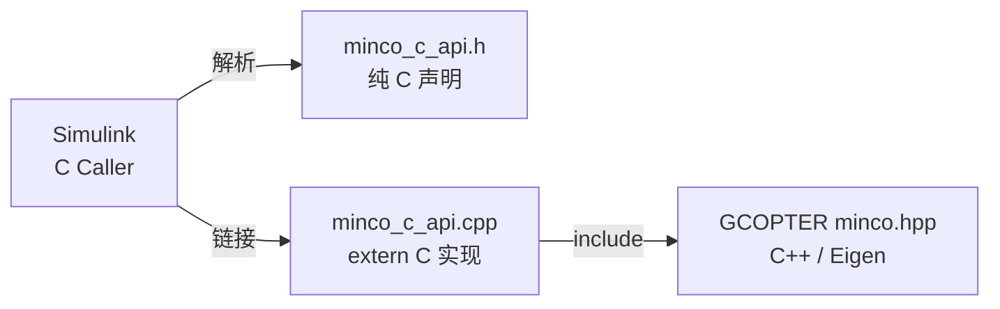
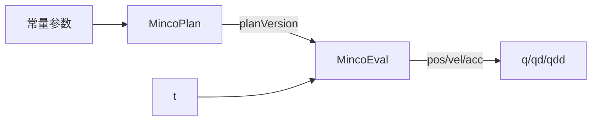

# 第 4 章 C/C++ 代码部署到 Simulink

本章目标：掌握把一个第三方 C++ 算法库（GCOPTER）接入 Simulink 的完整流程——**接口设计、编译配置、C Caller 端口规格、执行顺序与状态管理、脱离 Simulink 测试**。这套方法适用于任何你想在 Simulink 中复用的 C/C++ 代码。

## 4.1 Simulink 调用外部代码的几种方式

| 方式 | 适合场景 | 优点 | 缺点 |
|---|---|---|---|
| **C Caller** 模块 | 调用现成的 C 函数 | 自动解析头文件生成端口，支持代码生成，零胶水代码 | 只认 C 接口，不能直接调 C++ 类 |
| C Function 模块 | 在模块里写少量 C/C++ 代码调用库 | 可写初始化/终止代码，可直接用 C++ | 代码写在模块里，不便单独测试 |
| MATLAB Function + `coder.ceval` | 调用逻辑与 MATLAB 代码混合 | 灵活 | 需要手写类型声明 |
| S-Function / Legacy Code Tool | 复杂状态、多速率、老项目 | 能力最强 | 样板代码多，学习成本高 |

本项目选择 **C Caller**：MINCO 的使用方式就是"调用函数、拿到结果"，C Caller 最直接，而且 C 接口可以脱离 Simulink 单独测试。

## 4.2 C++ 库如何变成 C 接口

GCOPTER 是 C++ 写的（类、模板、Eigen），而 C Caller 只能解析 C 函数声明。解决办法是加一层**包装层**：



头文件的关键写法：

```c
#ifdef __cplusplus
extern "C" {
#endif

int minco_plan(int slot, int dim, int numWpts, const double *wpts,
               const double *vMax, const double *aMax, double timeScale,
               double *durations, double *totalTime);

int minco_eval(int slot, int planVersion, double t,
               double *pos, double *vel, double *acc, double *jerk);

#ifdef __cplusplus
}
#endif
```

**为什么需要 `extern "C"`？** C++ 编译器会对函数名做"名字修饰"（name mangling），把参数类型编码进符号名，比如 `minco_plan` 可能变成 `_Z10minco_planiiiPKdS0_S0_dPdS1_`。Simulink 生成的调用代码按 C 的规则找符号 `minco_plan`，就会链接失败。`extern "C"` 告诉 C++ 编译器"这个函数按 C 的规则命名"。

`#ifdef __cplusplus` 保证同一个头文件既能被 C 编译器解析（Simulink 解析头文件时），也能被 C++ 编译器使用（编译 `.cpp` 时）。

## 4.3 接口设计原则

好的 C 接口决定了后续一切是否顺利。`minco_c_api.h` 遵循了以下原则：

| 原则 | 本项目的做法 | 原因 |
|---|---|---|
| 只用基本类型 | `int`、`double`、`double*` | C Caller 自动映射为 `int32`、`double` 端口；结构体需要定义 Bus，麻烦得多 |
| 固定尺寸数组 | 最多 6 维、16 个路径点，用 `numWpts` 指明实际数量 | Simulink 信号尺寸在编译时确定，变长信号会让 C Caller 和代码生成都变复杂 |
| 列主序 | `wpts[d + MINCO_MAX_DIM * k]` | Simulink 矩阵在内存中按列存储，可以直接传，不用转置 |
| `const` 区分输入输出 | `const double *` 是输入，`double *` 是输出 | C Caller 据此推断端口方向 |
| 返回状态码 | `>0` 成功，`<0` 错误码 | 不抛异常、不打印，由 Simulink 侧决定如何处理（本项目用 Assertion） |
| 状态封装在库内 | 用 `slot` 索引静态存储 | 调用方不需要管理内存 |

错误码定义：

| 宏 | 值 | 含义 |
|---|---|---|
| `MINCO_ERR_SLOT` | -1 | slot 越界 |
| `MINCO_ERR_DIM` | -2 | 维度不在 1~6 |
| `MINCO_ERR_WPTS` | -3 | 路径点数不在 2~16 |
| `MINCO_ERR_LIMITS` | -4 | 限幅不为正 |
| `MINCO_ERR_NUMERIC` | -5 | 求解出现 NaN/Inf |
| `MINCO_ERR_NOPLAN` | -6 | 采样时还没有有效规划 |

## 4.4 编译配置：告诉 Simulink 去哪里找代码

需要配置的参数位于 **Configuration Parameters → Simulation Target**（仿真用）和 **Code Generation → Custom Code**（代码生成用）。本项目由 `scripts/configure_custom_code.m` 自动写入：

```matlab
set_param(mdl, ...
    SimTargetLang="C++", ...                 % 自定义代码按 C++ 编译
    SimParseCustomCode="on", ...             % 解析头文件，C Caller 才能列出函数
    SimCustomHeaderCode=header, ...          % #include "minco_c_api.h"
    SimUserIncludeDirs=includeDirs, ...      % minco/、GCOPTER/include、Eigen
    SimUserSources=source, ...               % minco_c_api.cpp
    TargetLang="C++", ...                    % 代码生成也用 C++
    CustomHeaderCode=header, ...
    CustomInclude=includeDirs, ...
    CustomSource=source);
```

| 参数 | GUI 中的位置 | 作用 |
|---|---|---|
| `SimCustomHeaderCode` | Simulation Target → Code Information → Include headers | C Caller 从这里解析出可调用的函数 |
| `SimUserIncludeDirs` | Include directories | 编译器的 `-I` 路径 |
| `SimUserSources` | Source files | 参与编译链接的源文件 |
| `SimTargetLang` | Language | 必须是 C++，因为 `.cpp` 中用了 Eigen |

**为什么每次启动都重新写入，而不是保存在模型里？** Eigen 的路径因机器而异（macOS Homebrew、Linux 系统目录、Windows 自定义目录）。启动时用 `find_eigen` 自动探测、写入后把模型的 Dirty 标志恢复原状，这样模型文件不包含机器相关的绝对路径，团队成员拉下代码就能用。

### 动手实验 4-1：在 GUI 中查看配置

1. 打开模型，按 `Ctrl+E` 打开配置参数
2. 进入 **Simulation Target**，查看 Include headers、Include directories、Source files 的内容
3. 双击 `TrajectoryGenerator/JointSpace/MincoPlan`，在 Function name 下拉框中，你会看到 `minco_plan` 和 `minco_eval`——这就是头文件解析的结果

## 4.5 C Caller 端口规格

选中函数后，C Caller 会根据声明自动创建端口。但它**猜不出指针指向的数组有多大**，也不确定非 `const` 指针是输入还是输出，需要手动指定。

自动解析的默认结果（以 `minco_plan` 为例）：

| 参数 | 默认作用域 | 默认尺寸 | 需要改成 |
|---|---|---|---|
| `slot, dim, numWpts` | Input | 1 | — |
| `wpts, vMax, aMax` | Input | -1（继承） | —（从输入信号继承即可） |
| `timeScale` | Input | 1 | — |
| `durations` | **InputOutput** | -1 | **Output，尺寸 `P.maxWpts-1`** |
| `totalTime` | **InputOutput** | -1 | **Output，尺寸 1** |
| 返回值 | Output | 1 | — |

在 GUI 中：双击 C Caller → **Port specification** 表格，修改 Scope 和 Size 列。

用脚本修改（本项目搭建时使用的方式）：

```matlab
b = "RobotTrajPlatform/TrajectoryGenerator/JointSpace/MincoPlan";
ps = get_param(b, "FunctionPortSpecification");
args = ps.InputArguments;
d = args(strcmp({args.Name}, "durations"));
d.Scope = "Output";
d.Size = "P.maxWpts-1";          % 尺寸可以写成工作区表达式
tt = args(strcmp({args.Name}, "totalTime"));
tt.Scope = "Output";
tt.Size = "1";
```

`FunctionPortSpecification` 返回的是句柄对象，修改属性会直接作用到模块上。

修改后 `MincoPlan` 有 7 个输入、3 个输出（返回值、durations、totalTime）；`MincoEval` 有 3 个输入、5 个输出（返回值、pos、vel、acc、jerk）。

> **注意**：Output 尺寸一定要和 C 代码实际写入的长度一致。C 代码写越界不会有任何提示，只会悄悄破坏内存，表现为莫名其妙的错误结果甚至 MATLAB 崩溃。本项目中 C 代码对未用的输出位置也会写 0，保证整块输出缓冲区都被定义。

## 4.6 执行顺序与状态管理

### 用数据依赖保证执行顺序

`minco_eval` 必须在 `minco_plan` 之后执行。C Caller 之间默认没有先后关系，而 C 代码里的共享状态 Simulink 看不见。解决办法是**把规划版本号作为 `minco_eval` 的输入**：



有了这条连线，Simulink 必然先执行 `MincoPlan`。`minco_eval` 同时检查 `planVersion > 0`，规划失败时返回错误码而不是输出垃圾数据。这种"**用信号表达隐藏依赖**"的技巧在接入有状态的外部代码时非常常用。

### 每步都调用 plan，但只算一次

两个 C Caller 的采样时间都设为 `P.Ts`，也就是 `minco_plan` 每 4 ms 被调用一次。它内部会比较本次输入与上次是否完全相同：

```cpp
PlanSlot &s = g_slots[slot];
if (!(s.valid && sameInput(s.input, in)))
{
    // 只有输入变化时才重新求解
    ...
    s.version = s.version % 1000000 + 1;
}
```

`sameInput` 用 `memcmp` 比较一个约 1 KB 的结构体，开销可以忽略。这个设计带来两个好处：

1. 路径点是常量时，只在第一步求解一次
2. 以后路径点变成运行时信号（比如由上层任务规划给出），**不用改任何 Simulink 结构**，输入一变就自动重新规划，版本号加 1

为了让 `memcmp` 可靠，`PlanInput` 先 `memset` 清零，再只拷贝有效部分，避免未用区域的随机值导致误判。

### slot：多实例互不干扰

关节空间用 slot 0，笛卡尔空间用 slot 1，`minco_mex` 实验用 slot 2。每个 slot 有独立的缓存和系数。这相当于一个极简的"对象池"，让纯 C 接口也能支持多个规划器实例。

> **注意**：静态存储在 MATLAB 会话期间一直存在，多次仿真之间不会自动清空。本项目靠"输入变化即重算"保证正确性；如果你的算法依赖"每次仿真从零开始"，需要额外提供一个 `reset` 函数，并在模型初始化时调用（例如放在 Initialize Function 子系统中）。

## 4.7 脱离 Simulink 测试

**算法 bug 应该在进入 Simulink 之前就被发现。** `tests/test_minco_c_api.cpp` 是一个不依赖 MATLAB 的测试程序：

```bash
mkdir -p build
clang++ -std=c++14 -O2 -Iminco -Ithird_party/GCOPTER/gcopter/include \
    -I/opt/homebrew/include/eigen3 \
    minco/minco_c_api.cpp tests/test_minco_c_api.cpp -o build/test_minco_c_api
./build/test_minco_c_api
```

它检查：

| 测试项 | 判据 |
|---|---|
| 经过路径点 | 误差 < 1e-9 |
| 起止静止 | 起终点速度、加速度 < 1e-9 |
| 加速度连续 | 相邻采样点加速度差 < 0.05 |
| 限幅 | 峰值利用率 ≤ 1.01，且至少一项 > 0.98（缩放是紧的） |
| 缓存 | 相同输入版本号不变，输入改变版本号加 1 |
| timeScale | 设为 2 时总时长正好翻倍 |
| 错误码 | 各类非法输入返回对应错误码 |

分层验证的思路：

```
C++ 单元测试（秒级）→ MEX 离线实验（第 3 章）→ Simulink 仿真（分钟级）
```

越靠前的层，反馈越快、定位越精确。

## 4.8 走向代码生成与嵌入式

模型已经配置了 `TargetLang="C++"` 和 `CustomSource` 等代码生成参数，用 Simulink Coder / Embedded Coder 生成代码时，C Caller 会变成对 `minco_plan` / `minco_eval` 的直接调用，`minco_c_api.cpp` 和 GCOPTER 头文件会一起参与编译。

真正部署到嵌入式控制器前，还需要考虑：

| 问题 | 现状 | 改进方向 |
|---|---|---|
| 动态内存 | GCOPTER 内部使用 `Eigen::MatrixX3d`、`new double[]` | 预分配最大尺寸，或改用固定尺寸 Eigen 类型 |
| 计算时间 | 求解是 \(O(N)\)，但 `requiredTimeScale` 采样 \(65 \times N \times \text{dim}\) 次 | 只在重规划时执行，不在每个控制周期执行（本项目的缓存已经保证了这一点） |
| 数值稳定性 | 带状 LU 不选主元 | 极端的时长比例下可能病态，可对 \(T\) 设上下限 |

## 4.9 本章小结

- C Caller 是调用现成 C 函数最简单的方式，C++ 库需要包一层 `extern "C"` 接口
- 接口设计：基本类型、固定尺寸、列主序、`const` 区分方向、状态码
- 编译配置写在 Simulation Target 和 Code Generation 中，机器相关路径在启动时动态写入
- 非 `const` 指针默认是 InputOutput，必须手动设为 Output 并指定尺寸
- 用"版本号"信号表达执行顺序，用输入比较实现缓存，用 slot 支持多实例
- 先在 C++ 层测试，再进 Simulink

## 4.10 练习

1. 把 `JointSpace/VelLimit` 的值改成 `zeros(6,1)` 后仿真，观察 `PlanFailedAssert` 报出的错误，并在 C 代码中找到对应的错误码。
2. 把 `MincoPlan` 的 `durations` 输出接到一个 Display 模块上，查看每段的时长。
3. 给 C 接口增加一个函数 `int minco_num_pieces(int slot)`，在 C Caller 中调用它并显示结果。思考它的执行顺序应该如何保证。
4. `MincoEval` 的返回值就是当前所在段号（从 0 开始），目前接在 `TermSegment` 上。把它改接到 Scope，观察段号的阶梯变化。
5. （进阶）给 `minco_eval` 增加一个输出参数 `double *localTime`，输出段内时间。改完头文件后，在 C Caller 的端口规格中把它设为 Output、尺寸 1。

下一章：[第 5 章 笛卡尔空间规划](05_笛卡尔空间规划.md)
