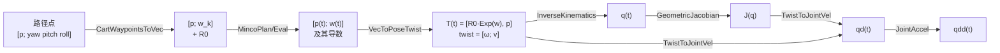

# 第 5 章 笛卡尔空间规划

本章目标：理解为什么姿态不能像位置一样直接插值，掌握 SO(3) 上的旋转向量、指数/对数映射和左雅可比，看懂笛卡尔分支从"位姿路径点"到"关节指令"的每一步。

## 5.1 关节空间 vs. 笛卡尔空间

| | 关节空间（MoveJ） | 笛卡尔空间（MoveL） |
|---|---|---|
| 规划对象 | 6 个关节角 | 末端位置 + 姿态 |
| 末端路径 | 不可预测的曲线 | 可控的空间曲线 |
| 计算量 | 只有规划 | 规划 + 每个周期一次 IK |
| 风险 | 几乎没有 | 奇异、不可达、IK 跳解 |
| 适用场景 | 点到点搬运、回零 | 焊接、涂胶、装配等需要沿路径运动的任务 |

两种模式在本项目中共用同一个 MINCO 接口：关节空间是 6 维关节角，笛卡尔空间是 6 维"位置 + 姿态向量"。难点全在**姿态怎么变成 3 个数**。

## 5.2 为什么不能直接对欧拉角插值

路径点的姿态用 ZYX 欧拉角 `[yaw pitch roll]` 给出，方便人填写。但直接对欧拉角做 MINCO 有三个问题：

1. **万向锁**：pitch = ±90° 时，yaw 和 roll 不再独立
2. **周期跳变**：yaw 从 179° 到 -179° 实际只转了 2°，数值上却差 358°
3. **角速度不对应**：欧拉角导数和物理角速度 \(\omega\) 之间的关系依赖于当前姿态，且在奇异处无界

更好的做法是在旋转群 SO(3) 的**局部坐标**上插值。

## 5.3 旋转向量、指数映射与对数映射

任何旋转都可以表示为"绕单位轴 \(n\) 转角度 \(\theta\)"，**旋转向量** \(w = \theta n \in \mathbb{R}^3\)。

记 \([w]_\times\) 为 \(w\) 的反对称矩阵：

\[
[w]_\times = \begin{bmatrix} 0 & -w_3 & w_2 \\ w_3 & 0 & -w_1 \\ -w_2 & w_1 & 0 \end{bmatrix}
\]

**指数映射**（旋转向量 → 旋转矩阵，Rodrigues 公式）：

\[
\mathrm{Exp}(w) = I + \frac{\sin\theta}{\theta}[w]_\times + \frac{1-\cos\theta}{\theta^2}[w]_\times^2
\]

**对数映射**（旋转矩阵 → 旋转向量）：

\[
\theta = \arccos\frac{\mathrm{tr}(R) - 1}{2},\qquad
w = \frac{\theta}{2\sin\theta}\begin{bmatrix} R_{32}-R_{23} \\ R_{13}-R_{31} \\ R_{21}-R_{12}\end{bmatrix}
\]

对数映射在 \(\theta \to 0\) 和 \(\theta \to \pi\) 时需要特殊处理，`CartWaypointsToVec` 中的 `so3Log` 分三种情况：

```matlab
function w = so3Log(R)
th = acos(min(max((trace(R) - 1) / 2, -1), 1));   % clamp 防止数值误差导致 acos 越界
v = [R(3,2) - R(2,3); R(1,3) - R(3,1); R(2,1) - R(1,2)];
if th < 1e-9
    w = 0.5 * v;                                  % 小角度：sinθ ≈ θ
elseif pi - th < 1e-6
    [~, i] = max(diag(R));                        % 接近 180°：v ≈ 0，改从对称部分取轴
    a = R(:, i); a(i) = a(i) + 1;
    w = th * a / norm(a);
else
    w = th / (2 * sin(th)) * v;
end
end
```

## 5.4 本项目的姿态参数化

以**第一个路径点的姿态 \(R_0\)** 为参考，其余每个路径点的姿态表示为相对 \(R_0\) 的旋转向量：

\[
R_k = R_0\, \mathrm{Exp}(w_k), \qquad w_k = \mathrm{Log}(R_0^\top R_k)
\]

这样每个路径点就变成了 6 维向量 \([x, y, z, w_1, w_2, w_3]\)，可以直接交给 MINCO。规划出 \(w(t)\) 后再还原：

\[
R(t) = R_0\, \mathrm{Exp}(w(t))
\]



**为什么相对首点，而不是相对世界坐标系？** 旋转向量在 \(\theta\) 接近 \(\pi\) 时不唯一（\(w\) 和 \(-w\) 表示同一个旋转附近的两种写法），在 \(\theta = 0\) 附近最"平坦"。工具姿态通常是"竖直朝下 + 一点偏转"，相对首点表示后，所有 \(w_k\) 都在 0 附近，远离 \(\pi\) 的奇异。

**限制**：每个路径点的姿态相对首点的转角必须小于 180°。对绝大多数机械臂作业已经足够；若需要更大的姿态变化，可以改为"相对上一个路径点"逐段表示。

> **对比**：另一种常见做法是对四元数做 SLERP 插值。SLERP 每段是测地线，但段与段之间只有 C0 连续，角速度会跳变。本项目的方式把姿态也纳入 MINCO，姿态变化和位置一样平滑。

## 5.5 从 \(\dot w\) 到角速度：左雅可比

IK 只需要位姿，但为了计算关节速度，还需要末端的**物理角速度** \(\omega\)。注意 \(\omega \ne \dot w\)！对 \(R = R_0\,\mathrm{Exp}(w)\) 求导可以得到：

\[
\omega = R_0\, J_l(w)\, \dot w
\]

其中 \(J_l\) 是 SO(3) 的**左雅可比**：

\[
J_l(w) = I + \frac{1-\cos\theta}{\theta^2}[w]_\times + \frac{\theta - \sin\theta}{\theta^3}[w]_\times^2
\]

当 \(w\) 很小时 \(J_l \approx I\)，此时 \(\omega \approx R_0 \dot w\)；转角越大，差别越明显。`VecToPoseTwist` 的实现：

```matlab
w = pos(4:6);
th = norm(w);
W = [0 -w(3) w(2); w(3) 0 -w(1); -w(2) w(1) 0];
if th < 1e-9
    E = eye(3) + W;
    Jl = eye(3) + 0.5 * W;
else
    E = eye(3) + sin(th) / th * W + (1 - cos(th)) / th^2 * (W * W);           % Exp(w)
    Jl = eye(3) + (1 - cos(th)) / th^2 * W + (th - sin(th)) / th^3 * (W * W); % J_l(w)
end
T = [R0 * E, pos(1:3); 0 0 0 1];
twist = [R0 * Jl * vel(4:6); vel(1:3)];   % [ω; v]，顺序与 Get Jacobian 一致
```

### 动手实验 5-1：数值验证左雅可比

用有限差分验证 \(\omega = R_0 J_l(w)\dot w\)：

```matlab
R0 = eul2rotm([0.3 0.2 -0.1], "ZYX");
w = [0.4; -0.7; 0.5];  wd = [0.2; 0.1; -0.3];  h = 1e-6;
Exp = @(x) expm([0 -x(3) x(2); x(3) 0 -x(1); -x(2) x(1) 0]);
R1 = R0 * Exp(w);  R2 = R0 * Exp(w + h * wd);
Om = (R2 - R1) / h * R1.';                 % 数值的 [ω]×
omegaNum = [Om(3,2); Om(1,3); Om(2,1)];
th = norm(w); W = [0 -w(3) w(2); w(3) 0 -w(1); -w(2) w(1) 0];
Jl = eye(3) + (1-cos(th))/th^2 * W + (th-sin(th))/th^3 * W^2;
omegaAna = R0 * Jl * wd;
norm(omegaNum - omegaAna)                  % ~3e-8，只剩有限差分误差
norm(omegaNum - R0 * wd)                   % ~0.16：直接用 ẇ 是错的
```

## 5.6 逐步 IK 与关节速度

### IK：位姿 → 关节角

每个周期把 \(T(t)\) 送入 `InverseKinematics`，初值取上一个周期的解（见第 2 章 2.5 节）。

### 关节速度：阻尼最小二乘

几何雅可比满足 \(\begin{bmatrix}\omega \\ v\end{bmatrix} = J(q)\,\dot q\)。直接求逆 \(\dot q = J^{-1}\,\text{twist}\) 在奇异附近会爆炸，`TwistToJointVel` 使用**阻尼最小二乘**（DLS）：

\[
\dot q = J^\top \left(J J^\top + \lambda^2 I\right)^{-1} \text{twist}, \qquad \lambda = 10^{-3}
\]

```matlab
lambda = 1e-3;
qd = J' * ((J * J' + lambda^2 * eye(6)) \ twist(:));
```

| 情况 | DLS 的行为 |
|---|---|
| 远离奇异（\(J\) 的奇异值 \(\gg \lambda\)） | 几乎等于 \(J^{-1}\) |
| 接近奇异 | 在失去能力的方向上"放弃"一点跟踪精度，换取有界的关节速度 |

用反斜杠 `\` 求解线性方程组，而不是显式调用 `inv`，这是数值计算的基本习惯。

### 关节加速度

`JointAccel` 对 \(\dot q\) 做离散微分得到 \(\ddot q\)。这是一个近似，会引入一个采样周期的滞后，但对监测和可视化足够。若需要精确的 \(\ddot q\)，应使用 \(\ddot q = J^{-1}(\dot{\text{twist}} - \dot J \dot q)\)，可作为练习。

> **注意**：`qd` 是由 twist 算出来的，而 `q` 是 IK 算出来的，两者在数值上并不严格互为积分关系。真机控制中常见的做法是只下发 `q`，或者用 `q` 的差分作为速度前馈。

## 5.7 动手实验 5-2：笛卡尔模式

```matlab
out = run_platform(PlanMode=2);
```

在结果图中观察：

1. **末端路径图**：品红色轨迹依次经过 1~6 号路径点，转角处是平滑曲线而非折线
2. **关节轨迹图**：关节曲线没有跳变
3. **限幅利用率图**：速度利用率约 0.19，远低于 1

再做一个对比实验：把 `cfg.cart.vMax` 前三个元素（线速度）从 0.25 改为 0.5，重新运行，观察总时长和关节速度利用率的变化。

## 5.8 本章小结

- 姿态不能直接对欧拉角插值，应在 SO(3) 的局部坐标（旋转向量）上插值
- 以首个路径点为参考，\(R_k = R_0\,\mathrm{Exp}(w_k)\)，把位姿变成 6 维向量交给 MINCO
- 物理角速度 \(\omega = R_0 J_l(w)\dot w\)，不等于 \(\dot w\)
- 关节角由逐步 IK 得到，关节速度由阻尼最小二乘得到
- 笛卡尔规划的轨迹在转角处会向内弯，必须检查是否进入奇异区

## 5.9 练习

1. 把某个路径点的 yaw 改成与首点相差 200°，会发生什么？如何修改 `CartWaypointsToVec` 以支持更大的姿态变化？
2. 在 `VecToPoseTwist` 中把 `Jl` 替换成 `eye(3)`，重新仿真，对比关节速度曲线。转角多大时差别才明显？
3. 把 `TwistToJointVel` 中的 `lambda` 改成 0.1，观察 `qd` 与 `q` 的差分之间的偏差变化，理解阻尼带来的精度损失。
4. （进阶）在笛卡尔分支中增加一个输出 `ikPoseError`（来自 IK 的 `Info.PoseErrorNorm`），在关节空间分支中输出 0，并在顶层画出它。

下一章：[第 6 章 Simscape 可视化](06_Simscape可视化.md)
