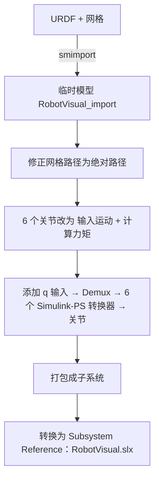

# 第 6 章 Simscape 可视化

本章目标：理解 `RobotVisual.slx` 是怎么从 URDF 自动生成的，学会 Simscape Multibody 中"运动驱动关节"的用法，以及 Subsystem Reference 的工程价值。

## 6.1 可视化方案选型

| 方案 | 优点 | 缺点 | 本项目 |
|---|---|---|---|
| Simscape Multibody + Mechanics Explorer | Simulink 原生，带真实网格，以后可扩展为动力学仿真 | 不能直接画末端轨迹线 | ✓ 主方案 |
| `show(rigidBodyTree)` 绘图 | 轻量，可叠加轨迹线、路径点 | 不是实时动画 | ✓ 仿真后分析（`plot_results`） |
| Simulink 3D Animation / Unreal | 效果最好 | 配置重 | 可扩展 |
| ROS 2 + RViz | 便于对接真机和 MoveIt | 需要 ROS 环境 | 可扩展 |

## 6.2 生成流程总览

`robot/build_robot_visual.m` 完成以下步骤，`startup_platform` 在 `RobotVisual.slx` 不存在或指定 `RebuildVisual=true` 时调用它：



### 动手实验 6-1：手动走一遍导入

```matlab
smimport(platformRobot.urdfFile, ModelName="tryImport");
```

打开生成的模型观察：

- 每个连杆（link）是一个包含惯性和几何体的子系统
- 每个关节（joint）是一个 `Revolute Joint` 模块
- 有 `World Frame`、`Mechanism Configuration`（重力）、`Solver Configuration` 三个全局模块

直接运行这个模型，机械臂会在重力作用下"瘫倒"——因为关节默认是被动的。下面就来解决这个问题。

## 6.3 关键一步：运动驱动关节

Simscape Multibody 的关节有两种驱动设置：

| 设置 | 选项 | 含义 |
|---|---|---|
| `MotionActuationMode` | `ComputedMotion`（默认）/ `InputMotion` | 关节角由动力学算出 / 由外部输入给定 |
| `TorqueActuationMode` | `NoTorque` / `InputTorque` / `ComputedTorque` | 不施加力矩 / 外部给定力矩 / 自动算出所需力矩 |

可视化需要"关节角严格等于规划结果"，所以设为：

```matlab
set_param(jointBlk, MotionActuationMode="InputMotion", TorqueActuationMode="ComputedTorque");
```

这相当于**逆动力学**模式：运动是给定的，Simscape 反算需要多大力矩。附带的好处是：以后打开 `SenseTorque` 就能直接得到关节力矩曲线，用来评估电机负载。

设置之后，关节模块会多出一个物理信号输入端口 `q`。脚本通过"唯一没有连线的端口"找到它：

```matlab
function port = freeMotionPort(jointPorts)
all = [jointPorts.LConn, jointPorts.RConn];
free = all(arrayfun(@(p) get_param(p, "Line") == -1, all));
...
end
```

## 6.4 Simulink 信号 → 物理信号

Simscape 使用"物理信号"，与普通 Simulink 信号之间需要 **Simulink-PS Converter** 转换。运动驱动对输入有一个硬性要求：**需要信号的一阶和二阶导数**（Simscape 要做二阶积分）。转换器提供两种方式：

| `FilteringAndDerivatives` | 含义 | 何时使用 |
|---|---|---|
| `provide` | 由用户额外提供导数信号 | 有精确导数时（如 MINCO 的 qd、qdd） |
| `filter` | 对输入做低通滤波，自动得到光滑导数 | 只有位置信号时 |

本项目用的是 `filter`，二阶、时间常数 0.01 s：

```matlab
set_param(conv, Unit="rad", FilteringAndDerivatives="filter", ...
    SimscapeFilterOrder="2", InputFilterTimeConstant="0.01");
```

选择 `filter` 是为了让可视化子系统**只需要一个输入 `q`**，接口最简单。代价是显示的位置比指令滞后约 10 ms，对观察来说无关紧要。如果以后要用它算关节力矩，就应该改为 `provide`，把 MINCO 输出的 qd、qdd 一起传进来，避免滤波误差。

`Unit="rad"` 同样重要：物理信号是带单位的，单位不对会导致关节转角放大或缩小 57.3 倍。

## 6.5 网格路径修正

导出的 URDF 中网格路径是相对路径，例如 `meshes/visual/base.stl`，而 URDF 位于 `urdf/` 子目录，相对 URDF 所在目录是找不到的。ROS 包中的 URDF 则常写成 `package://rokae_description/meshes/...`。

`resolveMesh` 的策略：从 URDF 所在目录开始，逐级向上最多 5 层查找，对 `package://包名/路径` 同时尝试"包名/路径"和"路径"两种写法，找到后写入绝对路径。找不到时给出警告，而不是静默失败。

这个函数处理的就是"不同来源的 URDF 写法不统一"这个现实问题，替换为 ROKAE 的 URDF 时同样适用。

## 6.6 Subsystem Reference：可替换的组件

生成的可视化部件保存为独立文件 `models/RobotVisual.slx`，主模型中用一个 **Subsystem Reference** 模块引用它：

| 方式 | 内容存放位置 | 适合 |
|---|---|---|
| 普通 Subsystem | 主模型文件内部 | 不会单独复用的逻辑 |
| **Subsystem Reference** | 独立的 `.slx` 文件，行为与普通子系统一样 | **可替换、可复用、需要独立版本管理的组件** |
| Model Reference | 独立模型，有自己的配置和编译单元 | 大型团队协作、增量编译 |

选择 Subsystem Reference 的原因：

1. **换机器人只替换一个文件**：重新生成 `RobotVisual.slx`，主模型完全不用动
2. **自动生成的内容与手工搭建的内容分离**：主模型由人维护，可视化由脚本生成，互不覆盖
3. 相比 Model Reference，Simscape 网络和 Mechanics Explorer 可以像在主模型中一样正常工作

## 6.7 动手实验 6-2：Mechanics Explorer 使用

```matlab
run_platform(PlanMode=1, Visualize=true);
```

Mechanics Explorer 常用操作：

| 操作 | 方法 |
|---|---|
| 旋转 / 平移 / 缩放 | 鼠标拖拽 / Shift+拖拽 / 滚轮 |
| 回放 | 仿真结束后用底部的播放控件重播 |
| 调整播放速度 | 工具栏中的 Playback Speed |
| 显示坐标系 | 工具栏中的 Toggle Frames |
| 导出视频 | 工具栏中的 Create Video |

不需要动画时（比如批量调参），用 `run_platform(Visualize=false)` 关闭，仿真会快很多。

## 6.8 本章小结

- `smimport` 把 URDF 变成 Simscape Multibody 模型
- 关节设为"输入运动 + 计算力矩"即可让机构精确跟随规划结果，同时能得到逆动力学力矩
- Simulink-PS 转换器需要输入的导数，可以滤波得到，也可以由规划器直接提供
- 网格路径需要按 URDF 的实际写法解析
- 自动生成的可替换部件用 Subsystem Reference 管理

## 6.9 练习

1. 在 `RobotVisual.slx` 中打开某个关节的 `SenseTorque`，把力矩输出到工作区，画出关节 2（肩部）在整条轨迹上的力矩曲线。
2. 把滤波时间常数从 0.01 改为 0.2，观察动画与指令之间的滞后。
3. （进阶）把可视化子系统的输入改为 `q, qd, qdd` 三个端口，转换器改为 `provide` 模式，修改 `build_robot_visual.m` 并重新生成。
4. （进阶）在 World Frame 上用 Rigid Transform + Spherical Solid 添加小球，标记出笛卡尔路径点的位置。

下一章：[第 7 章 仿真分析与调试](07_仿真分析与调试.md)
